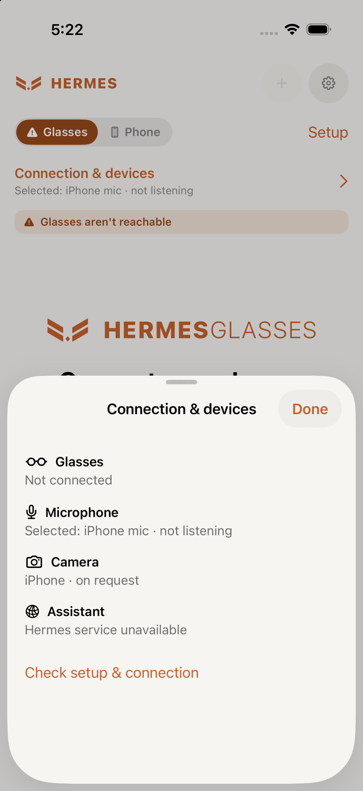
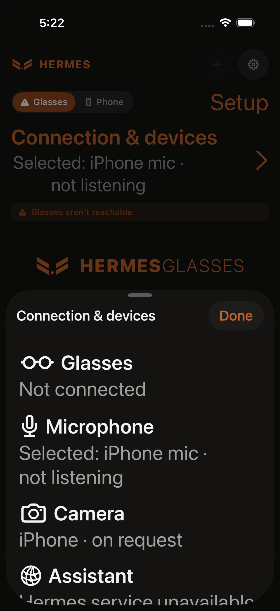
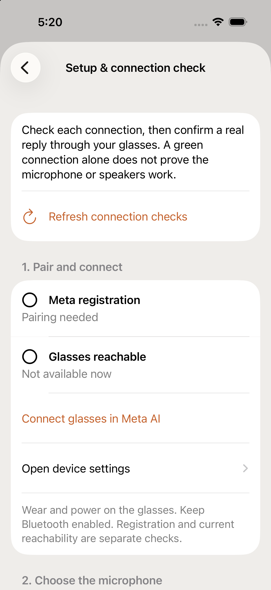
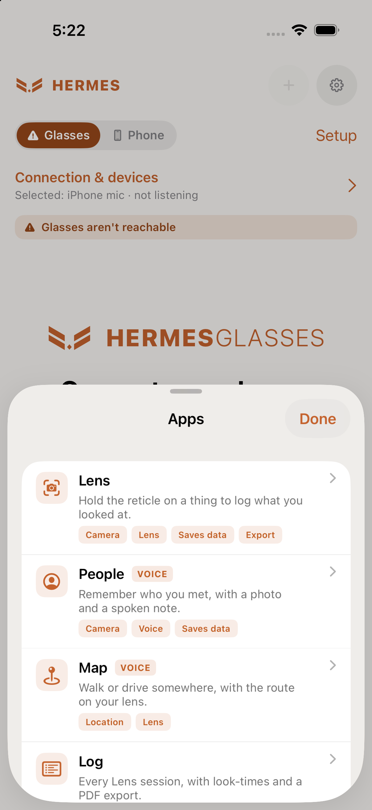
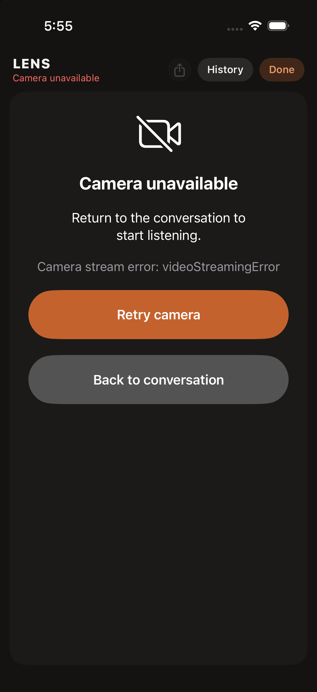

# Hermes Glasses iPhone GUI review — 2026-11-03

## Decision
Preserve the cream/terracotta identity and native SwiftUI navigation. Improve truthful status, discoverable controls and recovery before adding modes. This is a source audit of the whole GUI plus targeted simulator rendering, not full physical-device accessibility certification.

## Five implemented improvements
1. **Connection & devices:** one entry showing registration/session availability, actual audio-capture state, camera source and assistant reachability. Bluetooth input is labeled neutrally: device selection alone cannot prove the route is the glasses. Details scroll in a sheet rather than crowding the conversation.
2. **Recovery feedback:** reconnect progress/success is inline; genuine errors remain alerts. Informational microphone notices remain independently visible. The existing one-attempt idle-only recovery and no-request-replay policy is preserved.
3. **Simpler home:** Lens, optional Record and a labeled Tools entry. Setup is one tap away; header controls and End have 44-point interaction areas. Optional camera preview remains off by default.
4. **Optional status sounds:** persisted setting under Settings → Voice & Microphone, off by default. Short ready/processing/reconnecting/error tones use an existing Bluetooth HFP route; no route activation. Separate player, speech overlap guards and suppression across recognizer/VAD/recording/bridge microphone paths. Actual audibility requires wearer acceptance.
5. **Guided setup/support:** five sections for pairing, microphone, camera, assistant and wearer-confirmed spoken reply. Confirmation clears on session stop or relevant configuration changes. Share safe diagnostic summary uses an explicit allowlist, excluding endpoints, credentials, device names/IDs, conversation, location and raw errors. Reachability is explicitly not provider-authentication proof.

## Applied skills
Ten primary skills informed distinct aspects of this review; these are evaluation methods, not ten independent audits or a claim of current industry ranking. A delegated implementation additionally used swiftui-expert-skill.

| Skill | Contribution |
|---|---|
| impeccable | Native critique, hierarchy, actionable versus cosmetic findings; preserve existing identity |
| frontend-ux-master | Complete screen inventory and task-flow consistency |
| frontend-ui-ux-engineer | Component states, discoverability, interaction feedback |
| accessibility-audit | Touch targets, accessible names, non-color status, text scaling |
| swiftui-patterns | Native state/navigation and lifecycle-safe composition |
| design:design-system | Shared tokens and component consistency across screens |
| i18n-localization | Embedded strings, pluralization, longer text and locale readiness |
| design:user-research | Use actual wearer failures to prioritize status and setup work |
| design:ux-copy | Plain recovery messages and accurate capability labels |
| design:design-critique | Ranked whole-GUI critique with evidence and test limits |

React-only motion guidance and an iOS debug-bridge workflow were evaluated but not applied or counted. No debug bridge or telemetry dependency was added.

## Screen inventory and evidence
Source coverage: conversation, optional camera preview, Tools, Settings and nested pages, onboarding, Meta registration, Lens, saved object history/details, People encounters/recordings, navigation map, phone camera and simulated lens. Shared design and share components included.

Targeted rendered checks use an isolated iPhone 17 Pro simulator. Hardware is unavailable there, so disconnected states are expected; no connected state was fabricated. Screenshots in gui-audit are development evidence. Physical iPhone/VoiceOver and every nested screen have not been rendered during this pass.

## Ranked remaining recommendations
These are follow-up suggestions, not claims of implemented changes.

### Prevent loss and dead ends
| Priority | Evidence | Recommendation / acceptance |
|---|---|---|
| P1 | PeopleView delete actions; ObjectLogView delete actions | Confirm named deletion or offer undo. Verify cancellation preserves the record and delete removes only the chosen record. |
| P2 | LensView blank-feed branch always shows ProgressView; error header limited to two lines | Explicit terminal error card with full recovery text and Retry; spinner only while starting/recovering. |
| P2 | RegistrationView has indefinite spinner and Cancel only | Delayed pairing guidance, Open Meta AI and retry path. Test absent/disconnected glasses. |
| P2 | OnboardingView ready state checks essential permissions only | Say permissions ready; link to the real assistant/audio setup test before claiming everything works. |
| P3 | AppDrawerView disabled tool explains reason but offers no remediation | Add context-specific Set up action that opens the relevant setting. |

### Make controls readable and predictable
| Priority | Evidence | Recommendation / acceptance |
|---|---|---|
| P2 | Lens export and shared HermesChromePill use 30-point dimensions | Preserve visuals but expand interaction bounds to at least 44 points; verify adjacent targets do not overlap. |
| P2 | Fixed fonts throughout; non-scrolling onboarding/registration stacks | Semantic fonts and adaptive scrollable layouts; test smallest supported screen and accessibility text sizes. |
| P2 | Lens dwell slider lacks explicit accessible label/value; Canvas overlays have no semantic summary | Announce Capture delay in seconds, current detected object and capture progress; provide manual capture alternative. |
| P2 | Conversation waveform tap changes microphone or stops speech depending on state | Separate labeled microphone selector and Stop speaking action. |
| P3 | Existing animations across Lens, simulated lens and waveform | Respect Reduce Motion while keeping state changes perceptible. Main speaking symbol now respects it; broader work remains. |

### Explain capabilities and data clearly
| Priority | Evidence | Recommendation / acceptance |
|---|---|---|
| P2 | Lens capture persistence explained mainly after capture in Object Log | Explain Auto-save on this iPhone before first capture; distinguish transient conversation preview from saved Lens captures. |
| P2 | NavigationMapView uses On lens/HUD regardless of display capability | Gate by verified display support or use Route active. Camera/audio Ray-Bans must not imply a visual display. |
| P3 | Embedded strings, no string catalog found | Extract strings/plurals before localization; test long translations and retain locale-aware dates. |

## Integration review findings addressed
- Reconnected status previously masked subsequent microphone notices: notices now render independently.
- Selected Glasses Mic could fall back to another HFP device: UI and export now say Bluetooth input; wearer test remains the confirmation.
- Cue suppression initially covered only raw recognizer buffers: it now excludes converted VAD, recording and bridge paths too.
- Expanded connection details overflowed the home screen in a render check: details moved to a scrollable sheet.
- Setup confirmation could outlive its listening session: it now resets when session becomes inactive.

## Verification and limits
Scoped independent source review covered export allowlist, audio interference and no-replay recovery. Short transport fixture passed: invalid welcome rejection, redaction, Stop during delayed startup, stale welcome protection and exactly one delivery after interrupted request. The longer 65-second fixture passed in the preceding recovery work; not rerun for this UI change.

Prior wearer acceptance remains evidence for the previous build: glasses mic/speaker/camera, idle network handover, ten-minute foreground session, two-minute locked session, and simultaneous voice/preview with Hide/Show. It is not acceptance of the new sounds or setup UI.

Pending: new physical status-sound test, real-device VoiceOver traversal, full Dynamic Type pass, measured contrast, all-day use and prolonged live video. No all-screen accessibility or production-readiness certification is claimed.

### Executed checks for this update
- Signed physical-iPhone build: passed. Installation: passed. Automatic launch blocked because iPhone locked; wearer asked to open app and test sounds.
- Simulator build and launch: passed. Rendered home, setup, Tools and connection sheet; connection sheet also rendered dark with accessibility-large text. Initial overflowing inline detail layout was corrected before device installation.
- Independent integration recheck: no remaining blockers in scope.
- Short transport suite and cue PCM harness: passed. Diff whitespace check: passed.
- Existing compiler warnings remain (including API client Sendable capture); these are not a Swift 6 concurrency certification.

### Visual evidence

- Sanitized handoff snapshot unsigned iOS build passed. Gitleaks scan and known-private-identity pattern check passed.

## Lens recovery UI — 2026-11-03
Implemented terminal camera error panel with full error text, Retry camera, Back to conversation and voice-state-specific text. No indefinite spinner for terminal errors. Permission and automatic-reconnect states retain separate handling; retry preserves voice and saved captures. Cancelled camera-session startup now stops uncommitted SDK sessions. Signed build, terminal-state checks, source-derived SDK-double cancellation/failure/success regression and independent source recheck passed. Simulator fault injection rendered the panel; physical Lens/retry acceptance remains pending.

Status-sound follow-up: wearer confirmed manual test tone and automatic processing tone plus spoken reply. Recovery/error tones remain individually unverified.

Reference iPhone installation and launch passed. Sanitized handoff unsigned build and secret scan passed. Physical acceptance of this Lens update is pending.

- Physical acceptance follow-up: wearer confirmed Lens preview works and voice replies still work after closing Lens with Done. Normal preview/voice continuity passes by user report. No camera failure occurred in this check; Retry camera after a real failure remains unverified.
